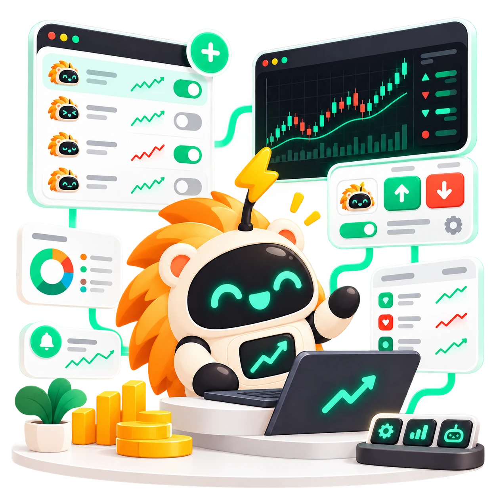

 

<picture>
  <source media="(prefers-color-scheme: dark)" srcset="./assets/readme/banner-dark.svg">
  <source media="(prefers-color-scheme: light)" srcset="./assets/readme/banner-light.svg">
  
</picture>

  

 

 

**토스증권 오픈API로 내 계좌를 연결하고, 단타 유형별 규칙을 가진 봇이 장중에 스스로 사고팔아요.** 
막 사고파는 봇이 아니라, **주문마다 근거·예측·결과가 남아 실력을 검증할 수 있는 봇**이에요.

 

<a href="#-어떤-서비스인가요">서비스 소개</a> &nbsp;•&nbsp;
<a href="#-주요-기능">주요 기능</a> &nbsp;•&nbsp;
<a href="#-봇-유형">봇 유형</a> &nbsp;•&nbsp;
<a href="#-봇은-이렇게-움직여요">동작 방식</a> &nbsp;•&nbsp;
<a href="#️-안전장치">안전장치</a> &nbsp;•&nbsp;
<a href="#️-아키텍처">아키텍처</a> &nbsp;•&nbsp;
<a href="#️-로드맵">로드맵</a> &nbsp;•&nbsp;
<a href="#-문서">문서</a>

 

<picture>
  <source media="(prefers-color-scheme: dark)" srcset="./assets/readme/divider-dark.svg">
  <source media="(prefers-color-scheme: light)" srcset="./assets/readme/divider-light.svg">
  
</picture>

## 💡 어떤 서비스인가요

단타를 직접 하면 장중 내내 화면을 봐야 하고, 감정적으로 사고팔게 돼요. 자동매매 봇을 써도 대부분 "샀다 / 팔았다"만 남아서 **왜 샀는지, 예상이 맞았는지** 알 수 없고, 규칙을 고쳐도 나아졌는지 판단할 수 없어요.

<picture>
  <source media="(prefers-color-scheme: dark)" srcset="./assets/readme/concept-dark.svg">
  <source media="(prefers-color-scheme: light)" srcset="./assets/readme/concept-light.svg">
  
</picture>

<table>
<tr>
<td width="25%" align="center" valign="top">

**🧾 근거 기록 100%**

모든 봇 주문에 판단 근거가 연결돼요

</td>
<td width="25%" align="center" valign="top">

**🎯 예측 정확도 비교**

봇별·기간별 적중률을 계산해요

</td>
<td width="25%" align="center" valign="top">

**🛡️ 사람 없이 작동하는 안전장치**

손실 한도를 넘는 주문 0건

</td>
<td width="25%" align="center" valign="top">

**🧪 소액으로 검증**

기준을 넘은 봇만 투자금을 늘려요

</td>
</tr>
</table>

> [!NOTE]
> 본인 1인용 서비스예요. 국내 주식(코스피·코스닥)만 다루고, 수익을 보장하거나 종목을 추천하지 않아요. 지금은 **기획·설계 단계**라 저장소에는 [문서](./docs/)만 있어요.

 

## ✨ 주요 기능

<picture>
  <source media="(prefers-color-scheme: dark)" srcset="./assets/readme/features-dark.svg">
  <source media="(prefers-color-scheme: light)" srcset="./assets/readme/features-light.svg">
  
</picture>

<b>F1 · 봇 생성·설정</b> &nbsp;유형 → 자금·기간 → 규칙 값 → 안전장치

 

- 유형과 투자 성향(공격적·중립·소극적)만 고르면 기본값이 채워져요. 숫자만 고쳐서 바로 시작해요
- 투자금은 운용 자산 대비 **정률(%)** 또는 **정액**으로 정하고, 시작 시점에 확정돼요
- 규칙 값을 바꾸면 **새 버전**으로 저장해서 버전별 성과를 비교할 수 있어요
- 신규 봇은 **투자금 상한(예: 10만 원)** 을 건 검증 구간으로 시작해요. 봇 단위 일시정지·재개·즉시 전량 청산을 지원해요

→ [기능 명세](./docs/product/features/f1-bot-setup.md) · [자금 배분 정책](./docs/policy/fund-allocation.md)

<b>F2 · 봇별 투자 실적</b> &nbsp;전체 요약 → 봇 비교 → 봇 상세 → 개별 거래

 

| 지표 | 보는 이유 |
| --- | --- |
| 누적·기간 수익률 | 기본 성과 |
| 승률 | 판단 정확도 감 잡기 |
| 손익비 | 승률이 낮아도 수익이 나는지 |
| 최대 낙폭(MDD) | 버틸 수 있는 위험인지 |
| 평균 보유 시간 | 유형 의도대로 동작하는지 |
| 거래 비용 합계 | 단타는 비용이 수익을 잠식하기 쉬움 |
| 벤치마크 대비 | 그냥 지수를 산 것보다 나은지 |

모든 순손익은 **수수료·세금을 뺀 값**이에요. → [기능 명세](./docs/product/features/f2-performance.md)

<b>F3 · 투자 근거 리포트</b> &nbsp;주문 전에 근거·예측 저장, 청산 후 자동 채점

 

- 근거는 **규칙과 숫자로만** 남겨요. "좋아 보여서" 같은 문장은 없어요
- 채점: **방향 적중**, **목표 도달률**, **예측 오차**
- 분석: 신뢰 점수 구간별 실제 승률, 조건별 기여도, 진입하지 않은 종목이 이후 어떻게 움직였는지까지 비교해요

→ [기능 명세](./docs/product/features/f3-rationale-report.md)

<b>F4 · 직접 거래 추적</b> &nbsp;앱에서 직접 한 거래도 같은 기준으로

 

- 계좌 체결 내역을 동기화해 봇 주문이 아닌 거래를 **직접 거래**로 자동 분류해요
- 원하면 직접 거래에도 목표가·손절가를 입력해 봇과 똑같이 채점받아요
- **나 vs 봇**: 수익률·승률·손익비·MDD·적중률을 같은 기간, 같은 기준으로 비교해요

→ [기능 명세](./docs/product/features/f4-manual-trades.md)

 

## 🤖 봇 유형

<picture>
  <source media="(prefers-color-scheme: dark)" srcset="./assets/readme/bots-dark.svg">
  <source media="(prefers-color-scheme: light)" srcset="./assets/readme/bots-light.svg">
  
</picture>

손실 중지 값은 <b>중립</b> 성향의 시작용 기본값이고, 검증 구간 결과를 보고 조정해요. 스윙·종가 베팅은 밤을 넘겨 보유해서 갭 하락 위험을 안내하고 장전·장후 재평가를 거쳐요. → <a href="./docs/policy/risk-management.md">리스크 관리</a> · <a href="./docs/policy/position-reevaluation.md">포지션 재평가</a>

 

## 🔁 봇은 이렇게 움직여요

장중에는 아래 8단계를 반복해요. 핵심은 **④ 판단 기록이 ⑤ 주문보다 먼저**라는 점이에요. 근거 저장에 실패하면 주문을 내지 않아요.

<picture>
  <source media="(prefers-color-scheme: dark)" srcset="./assets/readme/flow-dark.svg">
  <source media="(prefers-color-scheme: light)" srcset="./assets/readme/flow-light.svg">
  
</picture>

거래 한 건이 끝나면 이런 **근거 카드**가 남아요.

<picture>
  <source media="(prefers-color-scheme: dark)" srcset="./assets/readme/rationale-dark.svg">
  <source media="(prefers-color-scheme: light)" srcset="./assets/readme/rationale-light.svg">
  
</picture>

 

## 🛡️ 안전장치

모의(가상 투자금) 모드는 없어요. 새 봇은 실제 계좌로 매매하되 **투자금 상한**을 건 검증 구간으로 시작하고, 아래 기준을 **모두** 넘어야 상한을 풀 수 있어요. 화면뿐 아니라 서버에서도 막아요. 진입·청산 규칙처럼 판단이 바뀌는 변경만 검증을 다시 시작해요 → [기준](<./docs/policy/risk-management.md#9-검증-구간과-상한-해제-pol-risk-13>)

<picture>
  <source media="(prefers-color-scheme: dark)" srcset="./assets/readme/gate-dark.svg">
  <source media="(prefers-color-scheme: light)" srcset="./assets/readme/gate-light.svg">
  
</picture>

<table>
<tr>
<td width="50%" valign="top">

**⛔ 자동으로 멈춰요**

- 하루 손실 한도 도달 → 그날 신규 진입 중단
- 누적 손실 한도 도달 → 봇 종료, 남은 돈은 반환
- 연속 손절 3회 → 일시 정지, 사람이 재개
- 시세·잔고·DB 중 하나라도 불확실 → 신규 진입 중단

</td>
<td width="50%" valign="top">

**🧯 언제든 멈출 수 있어요**

- **킬 스위치**: 누르면 1초 안에 신규 주문 정지
- 봇 단위 일시정지 · 즉시 전량 청산
- 체결·손절·한도 도달·오류는 **텔레그램 알림**
- 같은 종목 중복 진입을 막는 **종목 잠금**

</td>
</tr>
</table>

<b>투자 성향별 손실 중지 기본값</b>

 

| 봇 유형 | 공격적 (하루 · 누적) | 중립 (하루 · 누적) | 소극적 (하루 · 누적) |
| --- | --- | --- | --- |
| 스캘핑 | -5% · -15% | -3% · -10% | -2% · -6% |
| 데이 트레이딩 | -6% · -15% | -4% · -10% | -2% · -6% |
| 스윙 | 종목당 -7% · -15% | 종목당 -5% · -10% | 종목당 -3% · -5% |
| 종가 베팅 | 1회 -5% · -15% | 1회 -3% · -10% | 1회 -2% · -6% |

손실에는 실현 손익과 보유분 평가 손익을 모두 넣어요(수수료·세금 차감 후). → [리스크 관리 정책](./docs/policy/risk-management.md)

 

## 🏗️ 아키텍처

<picture>
  <source media="(prefers-color-scheme: dark)" srcset="./assets/readme/architecture-dark.svg">
  <source media="(prefers-color-scheme: light)" srcset="./assets/readme/architecture-light.svg">
  
</picture>

<table>
<tr>
<td width="50%" valign="top">

**설계 원칙**

1. **규칙은 순수 함수**: 실전·개발 점검·백테스트가 같은 함수를 써요
2. **불확실하면 멈춤**: 수익 기회보다 안전이 먼저예요
3. **기록은 추가만**: 근거·주문·체결은 고치거나 지우지 않아요
4. **외부 API는 한 곳**: 토스 호출은 engine의 TossClient만 해요

</td>
<td width="50%" valign="top">

**기술 스택**

| 영역 | 선택 |
| --- | --- |
| 서버 (api · engine) | NestJS · TypeORM · Vitest |
| 웹 | Next.js |
| DB · 명령 전달 | PostgreSQL · LISTEN/NOTIFY |
| 알림 | Telegram Bot API |
| 배포 | 고정 IP VM + Docker Compose |

</td>
</tr>
</table>

결정 배경은 <a href="./docs/architecture/adr/">ADR</a>에 남겨요. 예) <a href="./docs/architecture/adr/0003-record-decision-before-order.md">ADR-0003 주문 전에 판단 기록</a>, <a href="./docs/architecture/adr/0005-in-house-paper-broker.md">ADR-0005 개발 점검용 모의 브로커</a>, <a href="./docs/architecture/adr/0007-single-market-collector.md">ADR-0007 시세 수집기 하나</a>

 

## 🗺️ 로드맵

잔고 연동과 근거 기록 구조를 먼저 완성하고, 봇은 하나씩 늘려요. **안전장치는 수익 로직보다 먼저** 만들어요.

<picture>
  <source media="(prefers-color-scheme: dark)" srcset="./assets/readme/roadmap-dark.svg">
  <source media="(prefers-color-scheme: light)" srcset="./assets/readme/roadmap-light.svg">
  
</picture>

<b>이후 버전 백로그</b>

 

직접 거래 추적 고도화 · 일일·주간 리포트 · 백테스트 · 봇 버전별 성과 비교 · A/B 비교 · 시장 상황 필터 · 전체 자금 관리 · 스캘핑 봇 · 이벤트 캘린더 · AI 해설 · 세금·비용 리포트

→ [로드맵](./docs/project/roadmap.md)

 

## 📚 문서

모든 기획·설계는 [`docs/`](./docs/)에 역할별로 나눠 두었어요. 처음이라면 **PRD → 용어집 → 기능 명세 → 정책 → 시스템 개요 → 로드맵** 순서로 읽어요.

| 폴더 | 답하는 질문 | 문서 |
| --- | --- | --- |
| [product/](./docs/product/) | 무엇을, 왜 만드나 | [PRD](./docs/product/prd.md) · [F1](./docs/product/features/f1-bot-setup.md) · [F2](./docs/product/features/f2-performance.md) · [F3](./docs/product/features/f3-rationale-report.md) · [F4](./docs/product/features/f4-manual-trades.md) |
| [policy/](./docs/policy/) | 코드가 지켜야 할 도메인 규칙 | [자금 배분](./docs/policy/fund-allocation.md) · [리스크 관리](./docs/policy/risk-management.md) · [포지션 재평가](./docs/policy/position-reevaluation.md) |
| [architecture/](./docs/architecture/) | 어떻게 만드나 | [시스템 개요](./docs/architecture/overview.md) · [데이터 모델](./docs/architecture/data-model.md) · [ADR](./docs/architecture/adr/) |
| [integrations/](./docs/integrations/) | 외부 시스템 사용법 | [토스증권 오픈API](./docs/integrations/toss-securities-api.md) · [DART Open API](./docs/integrations/dart-open-api.md) |
| [project/](./docs/project/) | 언제, 무엇이 불확실한가 | [로드맵](./docs/project/roadmap.md) · [미결정 사항](./docs/project/open-questions.md) · [리스크](./docs/project/risks.md) · [용어집](./docs/project/glossary.md) |
| [learning/](./docs/learning/) | 왜 이 기술을 골랐나 | [기술 선택 학습 자료](./docs/learning/README.md) (주제 13개) |

 

<picture>
  <source media="(prefers-color-scheme: dark)" srcset="./assets/readme/divider-dark.svg">
  <source media="(prefers-color-scheme: light)" srcset="./assets/readme/divider-light.svg">
  
</picture>

⚠️ 자동매매로 생긴 손실은 투자자 본인에게 귀속돼요. 이 프로젝트는 특정 전략이나 종목의 수익을 보장하지 않아요. 
API로 받은 시세·정보는 본인 매매 목적으로만 쓰고 제3자에게 배포하지 않아요 (토스 데이터 이용 정책).

  

README 그래픽은 <code>python3 assets/readme/build_svgs.py</code>로 다시 만들 수 있어요.

