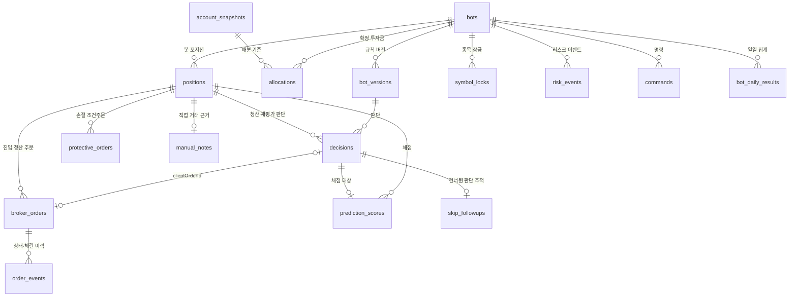

# 데이터 모델

> 상태: 초안 · 담당: @소닉 · 최종 수정: 2026-10-28
> 관련: [시스템 개요](./overview.md) · [자금 배분](../policy/fund-allocation.md) · [리스크 관리](../policy/risk-management.md) · [F3 근거 리포트](../product/features/f3-rationale-report.md) · [토스 API 연동](../integrations/toss-securities-api.md) · [05 DB와 ORM](../learning/05-database-and-orm.md)

PostgreSQL 스키마의 단일 출처예요. migration은 이 문서를 따라 만들고, 바뀌면 이 문서를 먼저 고쳐요. 규칙의 **이유**는 정책 문서에 있고, 여기서는 ID로만 가리켜요.

## 공통 규칙

| 항목 | 규칙 |
| --- | --- |
| 이름 | 테이블·컬럼은 `snake_case`, 테이블은 복수형(서버 하네스 규칙). 예약어 `order`는 피해서 `broker_orders`. 컬럼의 FK 이름은 단수(`bot_id`) |
| 기본 키 | `id bigint generated always as identity`. 예외: `decisions.id`는 UUID(= `clientOrderId`, [ADR-0003](./adr/0003-record-decision-before-order.md)), 자연 키가 있는 표(`disclosures`, `market_calendars`, `bot_daily_results`) |
| 금액·가격 | 원 단위 정수 `bigint`. 평균 체결가처럼 소수가 나오는 값만 `numeric(18,4)`. 코드에서는 둘 다 `number`로 받아요(`parseInt8`, `numericTransformer`) |
| 수량 | `integer` (국내 주식은 정수 주) |
| 비율 | 투자금·주문 비율은 0~1 소수(30% → `0.3`), 손실 한도·손익률·오차는 % 값(−2.5% → `-2.5`) |
| 시각 | `timestamptz`, 화면에서 Asia/Seoul로 표시. 거래일은 `date` |
| 상태·종류 값 | Postgres enum 대신 `text` + `CHECK (... IN (...))`. 값 추가가 migration 한 줄로 끝나요 |
| 공통 컬럼 | 모든 표에 `created_at timestamptz not null default now()`. 값을 갱신하는 표에만 `updated_at` |
| 외부 값 | 토스 응답의 문자열 숫자는 TossClient에서 숫자로 바꿔 저장해요. 토스 상태 값(`PENDING` 등)은 바꾸지 않고 그대로 저장 |
| `jsonb` | 모양이 유형마다 다른 값에만 써요(규칙 파라미터, 충족·탈락 조건, 원본 응답). DB가 모양을 검사하지 않으므로 저장 전에 코드에서 검증해요 |

**추가만 하는 표** ([NFR-04](../product/prd.md#7-비기능-요구사항)): `decisions`, `order_events`, `prediction_scores`, `risk_events`, `account_snapshots`. UPDATE·DELETE를 하지 않아요. DB 트리거가 UPDATE·DELETE를 거부해서(오류 코드 `23001`) 코드 실수도 막아요. `risk_events`는 `notified_at`을 null에서 한 번 채우는 것만 허용해요. 권한 회수(REVOKE)를 쓰지 않는 이유는 앱이 표 소유자 계정으로 접속해서 소유자에게는 회수가 통하지 않기 때문이에요.

**최신값을 갱신하는 표**: `broker_orders`의 상태·체결 합계, `positions`의 수량·손익, `protective_orders`의 상태처럼 "지금 상태"는 갱신하고, 바뀐 이력은 `order_events`·`risk_events`에 쌓아요.

**PaperBroker 기록**: 개발 점검(M3)은 같은 Postgres 서버의 **다른 database**(`tradelytics_paper`)를 써요. 스키마는 같고 컬럼으로 구분하지 않아요. 운영 기록과 섞일 수 없게 하기 위해서예요 ([ADR-0005](./adr/0005-in-house-paper-broker.md)).

**DB에 두지 않는 것**: 시세 스냅샷(engine 메모리, [ADR-0007](./adr/0007-single-market-collector.md)), 토스 토큰(engine 볼륨 파일), API 키·계좌 번호(환경 변수). api 프로세스도 DB를 읽으므로 비밀 값은 넣지 않아요.

## ERD

참조만 하는 표: `market_calendars`, `fee_schedules`, `disclosures`, `batch_runs`, `engine_statuses`, `quote_caches` (다른 표와 FK 없음).

**포지션 중심 구조**: 거래 1줄 = `positions` 1개 (FR-PERF-04). 진입 판단으로 첫 매수 주문을 낼 때 포지션을 만들고, 그 뒤의 분할 매수·매도 주문은 모두 같은 `position_id`를 가져요. 보유 수량이 0이 되면 닫아요. 직접 거래는 `bot_id`가 null인 포지션이에요(F4).

## 테이블

### 봇과 자금

#### `bots`

봇 하나. 자주 바뀌지 않는 설정과 현재 상태예요. 판단에 쓰이는 값은 `bot_versions`에 있어요.

| 컬럼 | 타입 | 제약 | 설명 |
| --- | --- | --- | --- |
| id | bigint | PK | |
| name | text | not null, unique | |
| type | text | not null, CHECK `scalping` `day_trading` `swing` `closing_bet` | 봇 유형 |
| risk_profile | text | not null, CHECK `aggressive` `neutral` `conservative` | POL-RISK-01, 05 |
| stage | text | not null, default `verifying`, CHECK `verifying` `released` | 검증 구간 (POL-RISK-13) |
| status | text | not null, default `ready`, CHECK `ready` `running` `paused` `waiting_funds` `stopped` | `waiting_funds`는 POL-FUND-15 |
| status_reason | text | | 정지·대기 사유 코드 (예: `daily_stop`, `streak_pause`, `insufficient_funds`, `bot_error`) |
| budget_type | text | not null, CHECK `ratio` `fixed` | 정률·정액 (POL-FUND-13~15) |
| budget_ratio | numeric(5,4) | CHECK 0 < x ≤ 1 | 정률일 때만 |
| budget_amount | bigint | CHECK > 0 | 정액일 때만 |
| start_priority | integer | not null | 정액 확정 순서 (POL-FUND-14). 기본값은 생성 순서 |
| trading_start | time | not null | 운영 시작 시각. 09:00~15:30 안 (POL-RISK-15) |
| trading_end | time | not null | 운영 종료 시각 |
| period_start | date | not null | 운용 기간 시작 |
| period_end | date | | null이면 무기한 |
| on_period_end | text | not null, CHECK `liquidate` `hold` | FR-BOT-08 |
| created_at, updated_at | timestamptz | not null | |

- CHECK: `(budget_type = 'ratio') = (budget_ratio is not null)`, `(budget_type = 'fixed') = (budget_amount is not null)`
- CHECK: `trading_start < trading_end`
- 정률 합 100% 검사(POL-FUND-03)는 여러 행에 걸친 규칙이라 api에서 검사해요

#### `bot_versions`

규칙이 바뀔 때마다 한 행씩 추가해요 (FR-BOT-03). 판단은 항상 특정 버전으로 기록돼요.

| 컬럼 | 타입 | 제약 | 설명 |
| --- | --- | --- | --- |
| id | bigint | PK | |
| bot_id | bigint | FK → bots, not null | |
| version | integer | not null | 1부터 |
| change_kind | text | not null, CHECK `initial` `decision_change` `risk_only` | `decision_change`면 검증 구간을 다시 시작, `risk_only`면 검증 기록 유지 (POL-RISK-13, FR-BOT-11) |
| params | jsonb | not null | 유형별 종목 필터·진입·청산 값 ([F1 유형별 규칙](../product/features/f1-bot-setup.md#유형별-규칙-기본값-제공-사용자는-숫자만-조정)) |
| order_size_type | text | not null, CHECK `ratio` `fixed` | 1회 주문 금액 방식 |
| order_size_value | numeric(18,4) | not null, CHECK > 0 | 정률이면 0~1, 정액이면 원 (POL-FUND-16) |
| split_count | integer | not null, CHECK ≥ 1 | 분할 매수 횟수 |
| max_positions | integer | not null, CHECK ≥ 1 | 동시 보유 종목 수 |
| daily_loss_pct | numeric(5,2) | not null, CHECK > 0 | 하루(스윙은 종목당, 종가 베팅은 1회) 손실 중지 % (POL-RISK-01) |
| total_loss_pct | numeric(5,2) | not null, CHECK > 0 | 누적 손실 중지 % |
| stop_streak | integer | not null, default 3 | 연속 손절 일시정지 횟수 (POL-RISK-04) |
| on_daily_limit | text | not null, CHECK `liquidate` `hold` | 하루 한도 도달 시 보유분 처리 (POL-RISK-02) |
| applied_at | timestamptz | | 실제 적용 시각. 쉬는 중에 저장하면 저장 시각과 같고, 아니면 쉬는 중이 된 뒤 적용돼 늦어요 (POL-RISK-13). null이면 적용 대기 |
| created_at | timestamptz | not null | |

- UNIQUE `(bot_id, version)`
- 현재 버전 = 그 봇에서 `applied_at`이 가장 늦은 행. 검증 구간 시작 = 마지막 `initial`·`decision_change` 버전의 `applied_at`
- 손실 %는 저장하는 순간의 숫자예요. 성향별 기본값 표는 [리스크 관리](../policy/risk-management.md#1-투자-성향별-손실-중지-pol-risk-01)에만 있어요

#### `account_snapshots`

배분 기준 시점의 운용 자산 (POL-FUND-01, 02, 09). 추가만 해요.

| 컬럼 | 타입 | 제약 | 설명 |
| --- | --- | --- | --- |
| id | bigint | PK | |
| taken_at | timestamptz | not null | 예: 08:59, 늦게 시작하는 봇은 그 시각 |
| orderable_cash | bigint | not null | 토스 `cashBuyingPower` |
| running_bots_cash_share | bigint | not null | Σ 실행 중 봇의 현금 몫 (계산식은 [자금 배분](../policy/fund-allocation.md#기본)) |
| available_capital | bigint | generated always as `(orderable_cash - running_bots_cash_share)` stored | 운용 자산 |
| created_at | timestamptz | not null | |

#### `allocations`

봇의 확정 투자금과 반환 기록 (POL-FUND-04, 06). 확정될 때 추가하고, 반환될 때 `released_*`만 채워요.

| 컬럼 | 타입 | 제약 | 설명 |
| --- | --- | --- | --- |
| id | bigint | PK | |
| bot_id | bigint | FK → bots, not null | |
| snapshot_id | bigint | FK → account_snapshots, not null | 같은 시각 시작 봇들은 같은 스냅샷 (POL-FUND-01) |
| amount | bigint | not null, CHECK > 0 | 확정 투자금 |
| capped | boolean | not null | 검증 구간 상한으로 줄었는지 (POL-FUND-11) |
| released_at | timestamptz | | 반환 시각 |
| released_amount | bigint | | 반환 금액 (손익·수익 포함, POL-FUND-06, 10) |
| created_at | timestamptz | not null | |

- 부분 UNIQUE `(bot_id) WHERE released_at IS NULL`: 봇당 살아 있는 배분은 1개
- CHECK: `(released_at is null) = (released_amount is null)`
- 투자금 다시 정하기(POL-FUND-12)는 기존 행을 반환 처리하고 새 행을 추가해요. 새 금액을 확정할 수 없으면 둘 다 하지 않아요
- 자금 부족 보류(POL-FUND-15)는 행을 만들지 않고 `bot.status = waiting_funds`로 남겨요

### 판단과 주문

#### `decisions`

근거 카드의 원본. 주문 전에 저장해요 ([ADR-0003](./adr/0003-record-decision-before-order.md)). 추가만 해요.

| 컬럼 | 타입 | 제약 | 설명 |
| --- | --- | --- | --- |
| id | uuid | PK | 그대로 `clientOrderId`로 써요 |
| bot_version_id | bigint | FK → bot_versions, not null | |
| position_id | bigint | FK → positions | 진입·청산·재평가 판단은 해당 포지션. 건너뛴 판단은 null |
| symbol | text | not null | 종목 코드 |
| kind | text | not null, CHECK `enter` `exit` `skip` `reeval` | |
| decided_at | timestamptz | not null | 판단 시점 |
| price | bigint | not null | 판단 당시 가격 |
| passed | jsonb | not null | 충족한 조건 `[{rule, value, threshold}]`. 규칙 id와 숫자만 (FR-RAT-07) |
| failed | jsonb | not null | 탈락한 조건, 모양은 `passed`와 같음 |
| score | smallint | CHECK 0~100 | 신뢰 점수 |
| direction | text | CHECK `up` `down` | 예측 방향 |
| target_price | bigint | | 예측 목표가 |
| stop_price | bigint | | 예측 손절가 |
| horizon_minutes | integer | | 예상 보유 시간 |
| skip_reason | text | CHECK `entry_condition` `risk` `funds` `symbol_locks` `market_alert` `order_rejected` `rate_limit` | 건너뛴 사유 (FR-RAT-03, 04) |
| created_at | timestamptz | not null | |

- CHECK: `(kind = 'skip') = (skip_reason is not null)`
- CHECK: `kind not in ('enter','reeval') or (direction is not null and target_price is not null and stop_price is not null)` — 채점할 판단은 예측이 있어야 해요
- INDEX `(bot_version_id, decided_at)`, `(position_id)`, `(symbol, decided_at)`
- 진입 판단은 포지션보다 먼저 저장되므로, 같은 트랜잭션에서 포지션을 먼저 만들고 판단을 넣어요
- 재평가의 경계 표시(POL-REEV-03)는 `passed`·`failed`에 규칙 값으로 넣어요 (예: `{rule: "us_etf_drop", value: -2.4, threshold: -2}`)
- 기록 범위는 [기록량 관리](#기록량-관리)를 따라요

#### `broker_orders`

토스 주문 1건 = 1행. 봇 주문, 손절 조건주문이 발동한 주문, 직접 거래 주문을 모두 담아요. 상태와 체결 합계는 최신값으로 갱신해요.

| 컬럼 | 타입 | 제약 | 설명 |
| --- | --- | --- | --- |
| id | bigint | PK | |
| origin | text | not null, CHECK `bot` `protective` `manual` | 봇 주문 / 손절 조건주문 발동 / 직접 거래 (FR-MAN-01) |
| decision_id | uuid | FK → decisions, unique | 봇 주문만. 주문 요청 전에 행을 만들어요 |
| position_id | bigint | FK → positions, not null | |
| broker_order_id | text | unique | 토스 `orderId`. 주문 응답을 받기 전에는 null |
| symbol | text | not null | |
| side | text | not null, CHECK `BUY` `SELL` | |
| order_type | text | not null, CHECK `LIMIT` `MARKET` | |
| time_in_force | text | not null, CHECK `DAY` `CLS` `OPG` | |
| price | bigint | | 지정가. 시장가는 null |
| quantity | integer | not null, CHECK > 0 | |
| status | text | not null | 우리 쪽 `requested`(응답 전)·`request_failed`(4xx로 접수 안 됨), 또는 토스 `OrderStatus` 값 그대로. 전이는 [주문 흐름](./order-lifecycle.md#주문-상태-전이) |
| reject_code | text | | `request_failed`일 때 토스 에러 코드 (예: `insufficient-buying-power`, `not_found`) |
| filled_quantity | integer | not null, default 0 | 토스 `execution` 값 그대로 (NFR-05) |
| avg_filled_price | numeric(18,4) | | |
| filled_amount | bigint | | |
| commission | bigint | | |
| tax | bigint | | |
| ordered_at | timestamptz | | 토스 `orderedAt` |
| filled_at | timestamptz | | 마지막 체결 시각 |
| canceled_at | timestamptz | | |
| settlement_date | date | | |
| synced_at | timestamptz | | 마지막으로 REST 주문 조회와 맞춘 시각 |
| created_at, updated_at | timestamptz | not null | |

- CHECK: `(origin = 'bot') = (decision_id is not null)`
- CHECK: `status in ('requested','request_failed') or broker_order_id is not null`
- CHECK: `(status = 'request_failed') = (reject_code is not null)`
- INDEX `(position_id)`, 부분 INDEX `(symbol) WHERE status IN ('requested','PENDING','PARTIAL_FILLED','PENDING_CANCEL','PENDING_REPLACE')` — 미체결 조회 (POL-FUND-05, POL-RISK-16)
- 토스 주문 조회에는 `clientOrderId`가 없어요. AccountSync는 `broker_order_id`로 봇 주문을 찾고, 없는 주문은 `protective_orders.triggered_order_id`와 맞춰 본 뒤 남은 것을 `manual`로 넣어요
- 봇은 주문 정정을 쓰지 않아요 ([연동 문서 주문 규칙](../integrations/toss-securities-api.md#주문-규칙)). 그래서 `decisions` 1개 = `broker_orders` 1개이고, 정정 이력 컬럼이 없어요. 정정된 주문(`REPLACED`)이 보이면 직접 거래에서 생긴 것이에요

#### `order_events`

주문 상태·체결 변화의 이력. 웹소켓 `personal:order` 이벤트와 REST 재동기화 결과를 쌓아요. 추가만 해요.

| 컬럼 | 타입 | 제약 | 설명 |
| --- | --- | --- | --- |
| id | bigint | PK | |
| order_id | bigint | FK → broker_orders, not null | |
| source | text | not null, CHECK `ws` `rest` | |
| status | text | not null | 이벤트 시점의 토스 상태 |
| filled_quantity_delta | integer | not null, default 0 | 이번 이벤트로 늘어난 체결 수량 |
| fill_price | bigint | | 건별 체결가 (웹소켓에만 있음) |
| occurred_at | timestamptz | not null | 토스 이벤트 시각 |
| raw | jsonb | not null | 원본 메시지 |
| created_at | timestamptz | not null | 받은 시각 |

- INDEX `(order_id, occurred_at)`
- 이벤트 합계와 REST 합계가 다르면 REST 값을 정답으로 `broker_orders`를 고치고, 그 사실도 `source = rest` 행으로 남아요
- `personal:order` 메시지 모양은 아직 확인 전이에요 ([연동 문서 남은 확인](../integrations/toss-securities-api.md#남은-확인-실제-호출로)). 확인 후 `fill_price`·`filled_quantity_delta`를 어디서 읽는지 적어요

#### `protective_orders`

손절 조건주문 (POL-RISK-11, 14). 수정하면 토스가 새 id를 주므로 새 행을 추가해요.

| 컬럼 | 타입 | 제약 | 설명 |
| --- | --- | --- | --- |
| id | bigint | PK | |
| position_id | bigint | FK → positions, not null | |
| broker_conditional_order_id | text | unique | 토스 `conditionalOrderId`. 응답 전 null |
| client_order_id | uuid | not null, unique | 조건주문 생성 멱등 키 |
| trigger_price | bigint | not null | |
| quantity | integer | not null, CHECK > 0 | 봇 보유 수량 |
| expire_date | date | not null | 당일 청산 봇은 당일, 이월 봇은 최대 보유일 |
| status | text | not null, CHECK `requested` `open` `canceling` `canceled` `triggered` `expired` | `canceling`은 취소 요청 후 확인 전 (POL-RISK-14의 "취소 확인 뒤 매도") |
| triggered_order_id | text | | 발동 시 토스 `triggeredOrderId` |
| closed_at | timestamptz | | 취소·발동·만료 시각 |
| created_at, updated_at | timestamptz | not null | |

- 부분 UNIQUE `(position_id) WHERE status IN ('requested','open','canceling')`: 포지션당 살아 있는 손절은 1개

#### `symbol_locks`

종목 잠금 (POL-RISK-16).

| 컬럼 | 타입 | 제약 | 설명 |
| --- | --- | --- | --- |
| id | bigint | PK | |
| symbol | text | not null | |
| bot_id | bigint | FK → bots, not null | |
| acquired_at | timestamptz | not null | |
| released_at | timestamptz | | |

- 부분 UNIQUE `(symbol) WHERE released_at IS NULL`: 잠금 획득은 INSERT 성공 여부로 판단해요. 두 봇이 동시에 잡으려 해도 DB가 하나만 통과시켜요

### 포지션과 결과

#### `positions`

거래 1줄 (FR-PERF-04). 수량·손익은 체결이 반영될 때 갱신해요.

| 컬럼 | 타입 | 제약 | 설명 |
| --- | --- | --- | --- |
| id | bigint | PK | |
| bot_id | bigint | FK → bots | null이면 직접 거래 (F4) |
| symbol | text | not null | |
| status | text | not null, CHECK `open` `closed` | |
| quantity | integer | not null, CHECK ≥ 0 | 현재 보유 수량 (봇 몫만, FR-MAN-02) |
| cost_basis | bigint | not null, default 0 | 보유분 매수 금액 (현금 몫 계산, POL-FUND-05) |
| realized_pnl | bigint | not null, default 0 | 실현 손익, 수수료·세금 차감 후 (NFR-05) |
| total_fees | bigint | not null, default 0 | 수수료 + 세금 합계 |
| high_price | bigint | | 보유 중 최고가 (채점의 목표 도달률) |
| low_price | bigint | | 보유 중 최저가 |
| opened_at | timestamptz | not null | |
| closed_at | timestamptz | | |
| exit_reason | text | CHECK `take_profit` `stop_loss` `time_exit` `market_close` `rule_exit` `loss_limit` `reeval` `manual` `kill_switch` `not_filled` | F2 청산 사유. `not_filled`는 한 주도 체결되지 않고 끝난 포지션 (F2에서 "취소"). `rule_exit`는 익절·손절이 아닌 규칙 청산(예: 데이 트레이딩 VWAP 이탈), `loss_limit`는 손실 한도 도달 청산 (POL-RISK-02, 03) |
| created_at, updated_at | timestamptz | not null | |

- CHECK: `(status = 'closed') = (closed_at is not null)`, `status = 'open' or quantity = 0`
- INDEX `(bot_id, status)`, `(bot_id, closed_at)`, 부분 INDEX `(symbol) WHERE status = 'open'`
- 평가 손익은 저장하지 않아요. 보유 수량 × 현재가로 화면·리스크 검사 때 계산해요

#### `prediction_scores`

예측 채점 (FR-RAT-02, POL-REEV-04). 최초 진입과 재평가 판단을 각각 채점해요. 추가만 해요.

| 컬럼 | 타입 | 제약 | 설명 |
| --- | --- | --- | --- |
| id | bigint | PK | |
| position_id | bigint | FK → positions, not null | |
| decision_id | uuid | FK → decisions, not null, unique | 채점한 판단 (`enter` 또는 `reeval`) |
| direction_hit | boolean | not null | |
| target_reach_pct | numeric(5,2) | not null, CHECK 0~100 | |
| error_pct | numeric(7,3) | not null | |
| scored_at | timestamptz | not null | |

채점 정의는 [F3 채점 정의](../product/features/f3-rationale-report.md#채점-정의)에만 있어요.

#### `skip_followups`

건너뛴 판단의 이후 가격 (FR-RAT-04). 장후 배치가 채워요.

| 컬럼 | 타입 | 제약 | 설명 |
| --- | --- | --- | --- |
| decision_id | uuid | PK, FK → decisions | `kind = skip`인 판단 |
| close_price | bigint | not null | 그날 종가 |
| max_after | bigint | not null | 판단 이후 장 마감까지 최고가 |
| min_after | bigint | not null | 최저가 |
| created_at | timestamptz | not null | |

#### `manual_notes`

직접 거래 근거 (FR-MAN-03). 자유 문장 메모를 허용해요(F4 예외).

| 컬럼 | 타입 | 제약 | 설명 |
| --- | --- | --- | --- |
| id | bigint | PK | |
| position_id | bigint | FK → positions, not null, unique | `bot_id`가 null인 포지션 |
| memo | text | | |
| target_price | bigint | | |
| stop_price | bigint | | |
| horizon_minutes | integer | | |
| created_at, updated_at | timestamptz | not null | |

#### `bot_daily_results`

장후 배치(15:40)의 봇별 일일 집계. 봇 상세의 일별 손익·누적 곡선·MDD에 써요 (FR-PERF-03).

| 컬럼 | 타입 | 제약 | 설명 |
| --- | --- | --- | --- |
| bot_id | bigint | PK, FK → bots | |
| trade_date | date | PK | |
| bot_version_id | bigint | FK → bot_versions, not null | 그날 적용된 버전 (검증 기준 계산, POL-RISK-13) |
| realized_pnl | bigint | not null | 그날 실현 손익 (차감 후) |
| unrealized_pnl | bigint | not null | 장 마감 기준 평가 손익 |
| fees | bigint | not null | |
| closed_trades | integer | not null | |
| created_at | timestamptz | not null | |

### 운영

#### `commands`

api → engine 명령 ([ADR-0004](./adr/0004-postgres-notify-for-commands.md)). 넣을 때 같은 트랜잭션에서 `NOTIFY command`.

| 컬럼 | 타입 | 제약 | 설명 |
| --- | --- | --- | --- |
| id | bigint | PK | |
| kind | text | not null, CHECK `pause` `resume` `liquidate` `kill` `rebudget` | POL-RISK-10, FR-BOT-09 |
| budget | jsonb | | `rebudget`의 새 투자금 설정(방식·금액·1회 주문 금액). 다른 명령은 null |
| bot_id | bigint | FK → bots | `kill`은 null (모든 봇) |
| liquidate_all | boolean | not null, default false | 킬 스위치의 "전량 청산" 선택 |
| requested_at | timestamptz | not null | |
| handled_at | timestamptz | | engine 처리 시각. null이면 미처리 |
| result | text | CHECK `ok` `failed` | |
| error | text | | |

- CHECK: `(kind = 'kill') = (bot_id is null)`
- 부분 INDEX `(requested_at) WHERE handled_at IS NULL`: engine 시작 시 미처리 명령 재조회

#### `risk_events`

리스크·장애 이벤트 (POL-RISK-02~04, 08, 11, POL-REEV-05). 알림(POL-RISK-12)의 근거 기록이에요. 추가만 해요.

| 컬럼 | 타입 | 제약 | 설명 |
| --- | --- | --- | --- |
| id | bigint | PK | |
| bot_id | bigint | FK → bots | 전체 대상이면 null |
| kind | text | not null, CHECK `daily_stop` `total_stop` `streak_pause` `rate_cap` `kill_switch` `batch_fail` `feed_stale` `record_fail` `order_rejected` `funds_waiting` `bot_error` | |
| occurred_at | timestamptz | not null | |
| detail | jsonb | not null | 기준값과 실제 값 (예: `{limit_pct: -4, actual_pct: -4.2}`) |
| notified_at | timestamptz | | 텔레그램 발송 시각. 이 컬럼만 예외로 한 번 채워요 |

- INDEX `(bot_id, occurred_at)`

#### `batch_runs`

engine 배치 실행 기록 ([엔진 배치 스케줄](./engine.md#배치-스케줄)). engine 시작 시 놓친 배치를 찾는 데 써요.

| 컬럼 | 타입 | 제약 | 설명 |
| --- | --- | --- | --- |
| id | bigint | PK | |
| job | text | not null, CHECK `pre_open` `open_snapshot` `open_check` `intraday_check` `post_close` `weekly_check` | |
| trade_date | date | not null | |
| slot | text | not null, default `''` | 하루 여러 번 도는 job의 회차 (예: `intraday_check`의 `11:00`) |
| started_at | timestamptz | not null | |
| finished_at | timestamptz | | |
| result | text | CHECK `ok` `failed` `skipped` | `skipped`는 휴장일 |
| error | text | | |

- UNIQUE `(job, trade_date, slot)`: 같은 배치를 두 번 시작하지 않아요. 실패한 배치를 다시 돌리면 같은 행을 갱신해요

#### `engine_statuses`

engine이 화면용으로 5초마다 덮어쓰는 한 행 ([API 원칙 1](./api.md#원칙), [엔진 화면용 상태 쓰기](./engine.md#화면용-상태-쓰기)). api는 토스를 부르지 않으므로 계좌 잔고와 engine 상태를 여기서 읽어요.

| 컬럼 | 타입 | 제약 | 설명 |
| --- | --- | --- | --- |
| id | smallint | PK, CHECK `id = 1` | 행은 하나뿐 |
| state | text | not null, CHECK `running` `stopping` `halted` | |
| halt_reasons | text[] | not null, default `{}` | 전체 정지 사유 (`kill`, `token`, `record_fail`) |
| stale_symbols | text[] | not null, default `{}` | 시세가 끊긴 종목 |
| orderable_cash | bigint | | 토스 `cashBuyingPower` 최근 값 |
| holdings_value | bigint | | 보유 종목 평가금액 합 |
| account_synced_at | timestamptz | | 위 두 값의 토스 조회 시각 |
| heartbeat_at | timestamptz | not null | engine 마지막 기록 시각 |

- 배분 기준(`account_snapshots`)과 다르게 이력을 남기지 않아요. 지금 값만 있어요

#### `quote_caches`

보유 종목의 최근 가격 (FR-PERF-06). engine이 메모리 스냅샷에서 5초마다 덮어써요. 보유가 끝난 종목 행은 장후 배치에서 지워요.

| 컬럼 | 타입 | 제약 | 설명 |
| --- | --- | --- | --- |
| symbol | text | PK | |
| price | bigint | not null | 최근 체결가 |
| received_at | timestamptz | not null | 시세 수신 시각 (화면의 기준 시각) |

#### `market_calendars`

토스 `market-calendar/KR` 사본.

| 컬럼 | 타입 | 제약 | 설명 |
| --- | --- | --- | --- |
| trade_date | date | PK | |
| is_open | boolean | not null | 통합 정규장(`integrated.regularMarket`)이 null이면 false. 정규장 없이 NXT 시간외만 열리는 날도 휴장으로 봐요 |
| regular_open_at | timestamptz | | 개장 지연일 대응 |
| regular_close_at | timestamptz | | |
| fetched_at | timestamptz | not null | |

#### `fee_schedules`

PaperBroker 체결 계산용 수수료·세금률 ([ADR-0005](./adr/0005-in-house-paper-broker.md)). 실전 손익은 토스 `execution` 값을 써요.

| 컬럼 | 타입 | 제약 | 설명 |
| --- | --- | --- | --- |
| id | bigint | PK | |
| effective_from | date | not null, unique | |
| commission_rate | numeric(8,6) | not null | 토스 `commissions` 값 |
| tax_rate | numeric(8,6) | not null | |

#### `disclosures`

DART 공시 목록 ([DART 연동](../integrations/dart-open-api.md)). 장전 점검의 공시 경계 근거예요.

| 컬럼 | 타입 | 제약 | 설명 |
| --- | --- | --- | --- |
| rcept_no | text | PK | 접수 번호 |
| stock_code | text | not null | |
| pblntf_ty | char(1) | not null | 공시 유형 (`B`, `I` 등) |
| report_nm | text | not null | |
| rcept_dt | date | not null | |
| fetched_at | timestamptz | not null | |

- INDEX `(stock_code, rcept_dt)`

## Postgres 기능 사용처

| 기능 | 어디에 | 비고 |
| --- | --- | --- |
| 부분 UNIQUE 인덱스 | `allocations`, `protective_orders`, `symbol_locks` | "살아 있는 행은 하나" 규칙을 DB가 보장 |
| generated column | `account_snapshots.available_capital` | 계산식이 코드와 어긋나지 않게 |
| LISTEN/NOTIFY | `commands` | ORM 밖에서 직접 SQL ([05](../learning/05-database-and-orm.md#감수한-것)) |
| 어드바이저리 락 | engine 단일 실행 | 표 없음. `pg_try_advisory_lock(상수)` |
| 트리거 | 추가만 하는 표 | UPDATE·DELETE 거부 (`risk_events.notified_at` 한 번 채우기만 허용). migration `protect-append-only-tables` |

## 기록량 관리

`decision(kind=skip)`은 많이 쌓여요. **종목 필터를 통과한 후보 중 진입 조건에서 떨어진 것과 리스크·자금 검사에서 막힌 것만** 기록하고, 이후 가격 추적은 장후 배치에서 한 번에 채워요.

`order_events.raw`는 체결이 많은 날 커질 수 있어요. 오래된 `raw`를 비우는 보관 정책은 실제 기록량을 보고 정해요.
