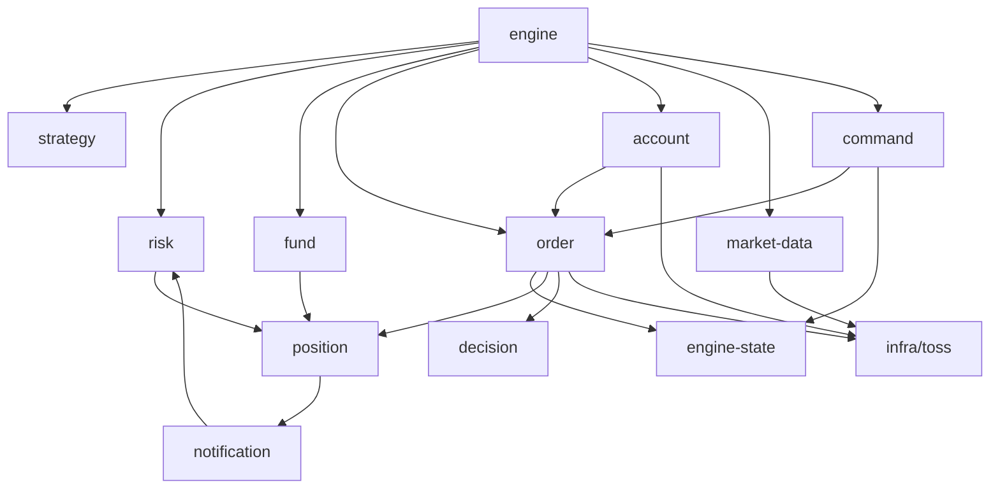

# 엔진 내부 설계

> 상태: 초안 · 담당: @소닉 · 최종 수정: 2026-10-29
> 관련: [시스템 개요](./overview.md) · [주문 흐름](./order-lifecycle.md) · [API 명세](./api.md) · [데이터 모델](./data-model.md) · [ADR-0002](./adr/0002-split-api-and-engine.md) · [ADR-0004](./adr/0004-postgres-notify-for-commands.md) · [ADR-0007](./adr/0007-single-market-collector.md)

engine 프로세스 안에서 **누가 무엇을 맡고, 어떤 순서로 켜지고 꺼지며, 서로 어떻게 부르는지**를 정해요. 주문 하나의 흐름은 [주문 흐름](./order-lifecycle.md), 무엇을 하는지(8단계, 일일 일정)는 [시스템 개요](./overview.md)에 있어요. 이 문서는 M1·M2 코드 구조의 기준이에요.

## 원칙

1. **주문은 한 곳에서만 나가요**: 토스 주문·취소 호출은 `OrderService`만 해요. 정지 여부도 HTTP를 보내기 직전에 여기서 마지막으로 확인해요. 그래서 킬 스위치가 루프 도중에 들어와도 주문이 나가지 않아요 (NFR-02)
2. **봇 하나의 오류는 그 봇에서 끝나요**: 봇 주기 실행은 봇마다 따로 예외를 잡아요. 한 봇이 실패해도 다른 봇과 프로세스는 계속 돌아요
3. **켤 때는 맞추고 나서 매매해요**: 시작 시 주문·잔고·명령을 DB·REST와 맞춘 뒤에만 BotRunner를 켜요
4. **잠금을 잃으면 바로 내려요**: engine이 둘 뜨면 이중 주문이 나요. 단일 실행 잠금이 풀리면 매매를 멈추고 프로세스를 끝내요
5. **엔진 안 호출은 메서드 호출로 해요**: 같은 프로세스 안이라 이벤트 버스를 두지 않아요. 의존 방향만 한쪽으로 지켜요 ([의존 방향](#의존-방향))

## 모듈 배치

[하네스 1절](../../apps/server/.sonic-harness-be/harness.md)의 구조를 따라요. 외부 API 클라이언트는 `src/infra/`, 도메인은 `src/modules/{feature}/`에 두고, 엔진 구성 요소는 각 feature의 `*.service.ts`예요.

```
apps/server/src/
├─ main.ts            api 진입점 (AppModule)
├─ engine.ts          engine 진입점 (EngineAppModule, HTTP 없는 application context)
├─ engine-app.module.ts
├─ infra/
│  ├─ database/       EngineLock(단일 실행 잠금), data-source, migrations
│  ├─ toss/           TossClient(REST·토큰·rate limiter), TossSocket(웹소켓 연결)
│  ├─ dart/           DartClient
│  └─ telegram/       TelegramClient
└─ modules/
   ├─ engine/         EngineLifecycle, BotRunner, EngineSchedule, batch_run
   ├─ engine-state/   EngineState (정지 상태, 의존 없음)
   ├─ market-data/    MarketCollector(시세 스냅샷), market_calendar
   ├─ account/        AccountSync, account_snapshot
   ├─ bot/            bot, bot_version
   ├─ fund/           allocation (POL-FUND)
   ├─ risk/           리스크 검사, symbol_lock, risk_event (POL-RISK)
   ├─ strategy/       유형별 규칙 평가 (*.rule.ts 순수 함수 + strategy.service.ts)
   ├─ decision/       decision, skip_followup
   ├─ order/          OrderService, Broker(TossBroker·PaperBroker), broker_order, order_event, protective_order
   ├─ position/       position, prediction_score, bot_daily_result
   ├─ command/        command (api가 넣고 engine이 처리)
   └─ notification/   NotificationService (risk_events → 텔레그램)
```

| feature | engine | api | 맡는 일 |
| --- | --- | --- | --- |
| `engine` | ✔ | | 시작·종료 순서, 봇 주기 실행, 배치 스케줄 |
| `engine-state` | ✔ | | 정지 상태(메모리) |
| `market-data` | ✔ | 캘린더 조회만 | 웹소켓 구독 선언, 종목별 스냅샷, REST 보정, 장 캘린더 |
| `account` | ✔ | 조회 | 주문·잔고 재동기화, 운용 자산 스냅샷 |
| `bot` | ✔ | ✔ | 봇 설정(api가 저장), 봇 상태 변경(engine) |
| `fund` | ✔ | 미리보기 | 투자금 확정, 한도 검사 (POL-FUND-05) |
| `risk` | ✔ | 조회 | 진입 금지·매매 시간·손실 한도·주문 횟수 검사, 종목 잠금 |
| `strategy` | ✔ | | `evaluate(type, params, snapshot)` |
| `decision` | ✔ | 조회 | 판단 저장 (추가만) |
| `order` | ✔ | 조회 | 주문·취소·손절 조건주문, 응답 유실 복구 |
| `position` | ✔ | 조회 | 체결 반영, 청산, 채점, 일일 집계 |
| `command` | 처리 | 저장 | LISTEN·재조회·처리 |
| `notification` | ✔ | | 알림 발송, `notified_at` 기록 |

- `EngineModule`과 `AppModule`은 feature 모듈을 골라 담아요. 같은 entity·repository를 쓰고, engine 전용 서비스(`bot-runner`, `account-sync`, `market-collector` 등)는 api 쪽 모듈에 넣지 않아요
- **규칙 평가는 `*.rule.ts`에 순수 함수로 둬요** ([Q-020](../project/open-questions.md#q-020)). 예: `strategy/day-trading.rule.ts`. rule 파일은 같은 feature의 `constants`·`types`와 `common`만 가져올 수 있어서 Nest·DB·시계(`Date.now()`)에 기대지 않아요. 시각도 `snapshot`으로 받아요. `strategy.service.ts`가 유형에 맞는 rule을 골라 부르고, 백테스트·테스트는 rule을 Nest 없이 바로 불러요. 이 레이어는 프로젝트 하네스(`eslint.base.mjs`의 `FEATURE_FILES`·import 규칙·rule 파일 제한, `harness.md` 1·7절)에 추가했어요(2026-10-29). 하네스 원본에는 `/sonic-harness-be:contribute`로 올려요
- **api가 토스를 부르지 않는다**(ADR-0002)는 `infra/toss`를 가져오는 서비스가 `AppModule` 그래프에 없다는 뜻이에요. dependency-cruiser 규칙 `api-no-toss`(`apps/server/.dependency-cruiser.cjs`)가 `src/main.ts`에서 `src/infra/toss`까지 가는 경로를 막아요. `npm run lint:cycles`와 CI에서 검사해요

### 의존 방향

순환이 생기지 않게 아래 방향으로만 불러요 (`lint:cycles`).



- 알림은 `notification`이 `risk_events` 중 알리지 않은 행을 읽어 보내요(outbox). 그래서 `risk`가 `notification`을 부르지 않고 반대 방향이에요. 기록이 먼저 커밋되고, 발송이 실패하거나 재시작해도 다음 주기에 다시 보내요
- `AccountSync`가 체결을 발견하면 `OrderService.applyExecution()`을 불러요. 손절 조건주문 등록도 그 안에서 해요. 반대 방향(`order` → `account`)은 없어요
- `EngineState`는 아무것도 가져오지 않는 작은 서비스라 `command`·`order`·`engine`이 모두 불러요. 그래서 `engine` feature와 따로 둬요

## 시작 순서

`engine.ts`가 Nest 앱을 띄운 뒤 `EngineLifecycle.start()`가 아래를 차례로 해요. 한 단계라도 실패하면 매매를 켜지 않고 알린 뒤 종료해요(Docker가 다시 띄워요).

| # | 단계 | 실패하면 |
| --- | --- | --- |
| 1 | DB 전용 연결을 열고 `pg_try_advisory_lock(ENGINE_LOCK)` (`EngineLock`) | 이미 다른 engine이 있음 → 즉시 종료 (`ENGINE_ALREADY_RUNNING`) |
| 2 | 토큰 파일 읽기, 만료 임박이면 재발급 | 종료 + 알림 |
| 3 | 오늘 `market_calendars` 확인, 없으면 토스에서 받기 | 종료 + 알림 |
| 4 | `bot.status`·오늘 `risk_events`로 [정지 상태](#정지-상태-enginestate) 복원 | 종료 + 알림 |
| 5 | 개발 점검이면 [PaperBroker](#개발-점검-paperbroker) 시작, `requested` 주문 정리 ([응답을 못 받았을 때](./order-lifecycle.md#응답을-못-받았을-때)) | PaperBroker는 종료 + 알림, 주문 정리는 해당 봇 신규 진입 중단 |
| 6 | 웹소켓 연결, 구독 선언 (`trade:kr`·`orderbook:kr`·`personal:order`). 연결을 기다리지 않아요 | 재시도. 계속 실패하면 `feed_stale`로 전체 신규 진입 중단 |
| 7 | AccountSync 전체 재동기화 (OPEN 전량 + 오늘 CLOSED), 장중 30초 재동기화 시작 | 종료 + 알림 |
| 8 | `LISTEN command`, 미처리 명령 처리 | 종료 + 알림 |
| 9 | `engine_statuses` 쓰기 시작, 놓친 배치 확인 ([배치 스케줄](#배치-스케줄)) 후 필요하면 실행 | `batch_fail` |
| 10 | 장중이면 BotRunner 시작 | — |

- 웹소켓(6번)을 재동기화(7번)보다 먼저 열어요. 재동기화하는 동안 들어온 체결 이벤트도 받기 위해서예요. 이벤트와 REST 조회는 AccountSync 안에서 한 줄로 차례로 반영돼서 같은 주문을 동시에 고치지 않아요
- 알림(`NotificationService`)은 1번 직후에 켜요. 시작 중에 남은 `risk_events`도 알리기 위해서예요
- 1번 잠금은 **연결에 묶인 잠금**이에요. 이 연결이 끊기면 Postgres가 잠금을 풀어요. 그래서 TypeORM 풀에서 연결 하나를 따로 잡아 두고(`QueryRunner`), 5초마다 `SELECT 1`로 확인해 끊기면 스스로 SIGTERM을 보내 [종료 순서](#종료-순서)로 내려요. 다른 engine이 잠금을 가져가기 전에 이 engine이 매매를 멈춰야 해요
- `LISTEN`도 같은 전용 연결을 써요. 풀 연결은 쿼리마다 바뀌어서 알림을 놓쳐요

## 종료 순서

`SIGTERM`(재배포)이나 잠금 연결 끊김에서 같은 순서로 내려요.

1. `EngineState`를 `stopping`으로 바꿔 신규 판단과 주문을 막아요 (원칙 1). 배치 예약·명령 처리·재동기화를 멈추고, `engine_statuses`에 `stopping`을 한 번 더 써요
2. 진행 중인 봇 주기와 이미 나간 주문 호출의 응답을 기다려요 (최대 10초). 응답을 못 받은 주문은 `requested`로 남고 다음 시작 때 정리해요
3. 웹소켓을 닫고 `UNLISTEN`, 잠금을 풀어요
4. **미체결 주문과 손절 조건주문은 그대로 둬요.** 손절은 서버가 없어도 증권사에서 작동해요 (POL-RISK-11)

재배포는 장 밖에 해요. 장중에 해야 하면 이 순서로 내리고 바로 다시 띄워요. 시작 순서 5~6번이 공백 동안의 체결을 채워요.

## 정지 상태 (EngineState)

신규 진입을 막는 이유는 여러 곳에서 생겨요. 메모리에 모아 두고 BotRunner와 `OrderService`가 매번 읽어요.

| 범위 | 이유 | 켜는 곳 | 푸는 곳 |
| --- | --- | --- | --- |
| 전체 | `kill` | 명령 처리 | 사람이 봇을 다시 시작 |
| 전체 | `stopping` | 종료 순서 | 프로세스 재시작 |
| 전체 | 토큰 반복 실패 (`401` 반복, R-014) | TossClient | 재발급 성공 후 사람이 확인 |
| 전체 | 판단 기록 저장 실패 (`record_fail`) | DecisionService | 사람이 확인 |
| 봇 | `pause`, 손실 한도, 연속 손절, 주문 횟수 상한 | 명령·RiskService | 사람이 재개 (하루 한도는 다음 거래일 자동) |
| 봇 | 응답 유실 주문 후보 2건 이상 | OrderService | 사람이 확인 |
| 봇 | 봇 주기 예외 (`bot_error`) | BotRunner | 사람이 재개 |
| 종목 | 시세 끊김 (`feed_stale`) | MarketCollector | 시세가 다시 들어오면 자동 |

- 메모리 값이 기준이고, 같은 내용을 `bot.status`·`risk_events`에 남겨요. 재시작하면 시작 순서 4번에서 다시 채워요
- 정지는 **신규 진입**만 막아요. 청산 매도, 손절 조건주문 취소·재등록, 미체결 취소는 막지 않아요. 손절 공백이나 청산 실패가 더 위험해서예요
- `stopping`은 모든 주문 호출을 막아요. `kill`도 BotRunner가 내는 주문은 모두 막고, 킬 스위치의 "전량 청산"만 명령 처리가 직접 `OrderService`에 청산 표시를 달아 내요

## 봇 주기 실행 (BotRunner)

봇마다 타이머 하나로 [8단계](./overview.md#봇-실행-흐름-8단계)를 반복해요.

- **주기**는 봇 버전 설정값이에요(유형별 기본값은 [F1](../product/features/f1-bot-setup.md)). 같은 봇의 주기는 겹치지 않아요. 이전 주기가 안 끝났으면 이번 주기는 건너뛰어요
- **운영 시간**(`trading_start`~`trading_end`)과 캘린더의 정규장 안에서만 돌아요 (POL-RISK-15). 당일 청산 봇은 청산 시각에 [청산 순서](./order-lifecycle.md#청산-손절-취소--매도--포지션-종료)를 실행해요
- **예외**는 봇 단위로 잡아요. 잡히지 않은 예외가 나면 그 봇을 `paused`(`status_reason = bot_error`)로 바꾸고 `risk_event(bot_error)`로 알려요. 같은 오류가 주기마다 주문을 반복하지 않게 하기 위해서예요
- **봇 설정이 바뀌면** 다음 주기에 반영해요. api가 바꾼 설정은 `command`로 보내지 않고, BotRunner가 주기마다 `bot.updated_at`을 보고 다시 읽어요. 봇이 시작·종료되면 타이머를 다시 맞추고 MarketCollector의 구독 목록도 다시 선언해요. 진행 중인 포지션은 진입할 때의 `bot_versions`을 계속 써요

지금 구현 (M3, 데이 트레이딩만):

- **M5 전까지는 개발 점검(`BROKER_MODE=paper`)에서만 켜요.** 실전 모드에서는 시작 순서 10번을 건너뛰고 경고만 남겨요
- 10초마다 정규장이면 `running`·`paused` 봇을 읽어요. 1분마다 거래대금 실시간 순위 50위를 받아 보유 종목과 함께 구독해요(`MarketScanService`)
- 봇마다 ③ 손실 한도(실현 + 보유분 평가, 하루·누적)·연속 손절 → ⑦ 청산 판단 → ①~⑤ 진입 순서예요. `paused` 봇은 청산만 해요(하루 한도로 멈추고 보유를 고른 봇도 15:15에는 청산)
- 진입은 주기마다 한 종목, 매도 1호가 지정가예요. 보유 중인 종목과 재진입 대기(`reentryCooldownMinutes`, 기본 30분) 중인 종목은 사지 않아요. 진입 직전에 매수 유의사항·거래정지를 다시 봐요(POL-RISK-06). 막힌 진입은 건너뛴 판단(`market_alert`·`funds`)으로 같은 날 같은 사유는 한 번만 남겨요
- 청산은 시장가예요. 미체결 주문이 있는 포지션은 결과를 기다려요. 분할 익절 단계 수는 체결된 봇 매도 수로 알아요
- 주문 횟수 상한(POL-RISK-08)은 `OrderService.enter`가 봐요. 청산은 막지 않아요
- 연속 손절은 봇 상태가 마지막으로 바뀐(재개) 뒤 닫힌 포지션만 세요

아직 없는 것: 분할 매수(`split_count`), 진입 조건 탈락 후보 기록(FR-RAT-04).

Node는 한 스레드라 봇이 많아도 동시에 하나씩 돌아요. 규칙 평가는 메모리 계산이라 짧고, 기다리는 시간은 대부분 DB·HTTP예요. 무거운 계산(예: 긴 기간 지표)이 생기면 그때 나눠요.

## 시세 스냅샷 (MarketCollector)

[ADR-0007](./adr/0007-single-market-collector.md)의 구현이에요.

| 항목 | 정한 것 |
| --- | --- |
| 스냅샷 | 종목별로 최근 체결가·체결량·누적 거래량, 호가, 마지막 수신 시각. 봇은 읽기만 해요 |
| 구독 목록 | 실행 중인 봇들의 관심 종목 + 보유 종목을 합쳐 전체를 다시 선언해요. 100건을 넘으면 보유 종목 → 진입 후보 순으로 남기고 나머지는 REST 폴링 |
| 오래된 시세 | 종목별 마지막 수신이 기준(예: 30초)보다 오래면 `prices` REST로 보정해요. 보정도 실패하면 그 종목을 `feed_stale`로 막아요 |
| 연결 끊김 | 재연결 → 재선언 → AccountSync 재동기화 (끊긴 동안의 `personal:order` 이벤트는 다시 오지 않아요) |
| `personal:order` | 받은 이벤트를 AccountSync에 넘겨요. MarketCollector는 주문 내용을 해석하지 않아요 |

웹소켓 메시지의 숫자는 문자열이에요(`"price":"230000"`). 스냅샷에 넣기 전에 숫자로 바꿔요 ([연동 문서 웹소켓](../integrations/toss-securities-api.md#웹소켓)).

## 개발 점검 (PaperBroker)

[ADR-0005](./adr/0005-in-house-paper-broker.md)의 구현이에요. `BROKER_MODE=paper`면 `OrderService`가 주문·취소·손절 조건주문을 토스 대신 `PaperBrokerService`로 보내요. 나머지 흐름(판단 기록, 주문 저장, 체결 반영, 포지션)은 실전과 같아요.

| 항목 | 정한 것 |
| --- | --- |
| 켜는 조건 | `DATABASE_URL`의 DB 이름이 `_paper`로 끝나야 해요(예: `tradelytics_paper`). 아니면 env 검증에서 시작하지 않아요. 운영 기록과 섞이지 않게 하기 위해서예요 |
| 체결 | 정규장에서 1초마다 MarketCollector 스냅샷으로 맞춰 봐요. 시장가는 상대 1호가에서 1틱 불리하게, 지정가는 상대 1호가가 닿으면 그 호가로 전량 체결해요(`paper.rule.ts`) |
| 비용 | `fee_schedules`에서 그 날 적용되는 수수료·세금률(세금은 매도만). 없으면 engine이 시작하지 않아요 |
| 손절 조건주문 | 최근 체결가가 발동가 이하면 시장가 매도를 내고 `stopState`로 발동 주문 id를 알려 줘요 |
| 거부 | 같은 종목 반대 방향 미체결이 있으면 `opposite-pending-order-exists` |
| 장 마감 | 정규장이 끝나면 미체결 `DAY` 주문을 취소하고, 만료일이 지난 손절을 지워요 |
| 결과 전달 | `personal:order` 이벤트처럼 `applyReport(report, 'ws')`로 한 건씩 넘겨요. 실패하면 다음 주기에 다시 넘겨요 |
| 재시작 | 모의 주문은 메모리에 있어요. 시작할 때 DB의 미체결 봇 주문(오늘 것)과 걸려 있는 손절을 다시 맡고, 지난 날 미체결은 취소해요 |
| 실제 계좌 | `personal:order` 구독과 AccountSync REST 재동기화를 끄고, 실제 계좌 주문을 가져오지 않아요. 시세와 토큰은 실전 키로 받아요 |

아직 없는 것: 부분 체결(호가 잔량), 상·하한가 거부, 점검용 투자금 상한. 자금 배분의 운용 자산은 지금 실제 계좌 `buying-power`를 읽어요. BotRunner(M3)를 붙일 때 정해요.

실행 준비:

1. 같은 Postgres에 `tradelytics_paper` DB를 만들고 `DATABASE_URL`을 그쪽으로 바꿔 `npm run migration:run`
2. `apps/server/.env.paper`(커밋하지 않아요)에 `.env` 위에 덮어쓸 값을 둬요: `BROKER_MODE=paper`, `DATABASE_URL=…/tradelytics_paper`
3. `scripts/paper-seed.sql`로 수수료율(0.015%, 세금 0.2%)과 데이 트레이딩 봇 1개(정액 10만 원, 1회 5만 원, 동시 2종목)를 넣어요. `_paper` DB가 아니면 거부하고, 다시 실행해도 같은 행을 넣지 않아요
4. `npm run build && npm run start:engine:paper`. 실전 engine을 먼저 내려요. 토스 토큰·웹소켓을 같은 클라이언트로 쓰기 때문이에요 (R-014)
5. 08:59 `open_snapshot`이 봇 투자금을 확정하고(늦게 켜면 시작할 때 따라잡아요), 정규장에 BotRunner가 돌아요

**리플레이(장 밖에서 미리 점검)**: 지난 장 하루치 1분봉으로 BotRunner·PaperBroker·OrderService를 실제 Postgres(Testcontainers) 위에서 10초 간격으로 다시 돌려요. 진입·분할 익절·VWAP 이탈·15:15 청산·손절 조건주문 순서·채점까지 하루 흐름을 몇십 초 안에 봐요. 시세는 그 날 거래대금 상위 50종목의 1분봉이라 실제 호가보다 거칠어요.

1. 그 날 장 마감 뒤, engine 토큰이 살아 있을 때 받아요(토큰을 새로 발급하지 않아요): `node --env-file=.env scripts/replay-fetch.mjs 2026-10-30 /tmp/replay.json`
2. `REPLAY_FILE=/tmp/replay.json npm run test:replay`. 봇 예외·기록 실패, 같은 포지션 진입 주문 반복, 장 마감 뒤 남은 보유가 있으면 실패하고, 판단·주문·포지션·손절·채점 요약을 출력해요

## 화면용 상태 쓰기

api는 토스를 부르지 않아서([API 원칙](./api.md#원칙)), 화면에 필요한 실시간 값은 engine이 5초마다 DB에 덮어써요.

| 표 | 쓰는 것 | 출처 |
| --- | --- | --- |
| [`engine_statuses`](./data-model.md#engine_statuses) | 상태·전체 정지 사유·시세 끊긴 종목·heartbeat, 마지막 주문 재동기화 시각, 주문 가능 금액·평가금액 | `EngineState`, MarketCollector, AccountSync (`StatusReporter`가 모아서 써요) |
| [`quote_caches`](./data-model.md#quote_caches) | 보유 종목의 최근 체결가 | MarketCollector 스냅샷 |

- 이 쓰기가 실패해도 매매는 계속해요. 화면에서는 `heartbeat_at`이 30초 넘게 오래되면 "엔진 응답 없음"으로 보여요
- 잔고는 이 용도로 따로 조회하지 않아요. AccountSync가 재동기화 때 받은 값을 써요
- M1 현재: 잔고(`buying-power`)를 아직 조회하지 않아서 주문 가능 금액·평가금액은 null로 써요

## 명령 처리 (command)

[ADR-0004](./adr/0004-postgres-notify-for-commands.md)의 구현이에요.

1. `NOTIFY command`를 받거나 5초마다 `handled_at is null` 명령을 `requested_at` 순으로 읽어요. 알림은 깨우는 신호로만 쓰고, 처리할 내용은 항상 테이블에서 읽어요
2. 명령마다 아래를 처리하고 `handled_at`, `result`를 채워요. 같은 명령을 두 번 처리해도 결과가 같게 만들어요(이미 정지된 봇의 `pause`는 `ok`)

| kind | 처리 | 1초 안에 끝낼 것 |
| --- | --- | --- |
| `kill` | ① `EngineState` 전체 정지 ② 모든 봇 `stopped` ③ 봇 미체결 주문 취소 ④ `liquidate_all`이면 봇별 청산 순서 ⑤ `risk_event(kill_switch)` | ①. 이후 BotRunner의 주문 호출이 0건이에요 (NFR-02) |
| `pause` | 봇 정지, 미체결 진입 주문 취소, 보유분·손절 유지 | 봇 정지 |
| `resume` | 정지 사유를 지우고 다음 주기부터 실행. 손실 한도 정지는 풀지 않아요 | — |
| `liquidate` | 봇 정지 → 미체결 취소 → 청산 순서로 시장가 매도 | 봇 정지 |
| `rebudget` | 쉬는 중인지 다시 확인하고, 맞으면 투자금을 반환한 뒤 `commands.budget` 설정으로 새로 확정. 쉬는 중이 아니거나 돈이 모자라면 `failed`로 남기고 기존 투자금을 그대로 둬요 (POL-FUND-12) | — |

- `resume`이 성공하면 그 봇의 정지와 함께 전체 `kill`도 풀어요. 재시작할 때는 마지막 `kill_switch` 뒤에 성공한 `resume`이 없으면 `kill`을 다시 걸어요
- M1 현재: 주문·취소(`OrderService`)가 아직 없어서 미체결 취소와 청산은 하지 않아요. `kill`의 `liquidate_all`, `liquidate`, `rebudget`은 정지만 하고 `result = failed`와 이유(`error`)를 남겨요. M2 주문 흐름에서 붙여요
- 취소·매도처럼 시간이 걸리는 일은 1초 기준에 넣지 않아요. 기준은 "신규 주문이 더 나가지 않는 것"이에요
- 처리 결과는 `commands.result`로 남고, 화면은 그 값을 보고 완료를 표시해요

## 배치 스케줄

[일일 일정](./overview.md#일일-일정-engine)과 [재평가 일정](../policy/position-reevaluation.md#실행-일정)을 `EngineSchedule`이 실행해요. 시각은 KST(서머타임 없음, `+09:00` 고정)예요. 정해진 시각이 몇 개뿐이라 `@nestjs/schedule` 없이 `setTimeout`으로 다음 시각을 예약해요. 요일 조건(`weekly_check`)처럼 cron 표현이 필요해지면 그때 설치해요([학습 06](../learning/06-scheduling.md)).

지금 등록한 job은 할 일이 있는 `pre_open`(토큰·캘린더 확인, 하루 손실 한도 정지 재개), `open_snapshot`(봇 투자금 확정), `post_close`(오늘 CLOSED로 체결 최종 확정, 닫힌 포지션의 판단 채점)뿐이에요. 나머지는 그 기능을 만들 때 더해요.

| job | 시각 | 하는 일 |
| --- | --- | --- |
| `pre_open` | 08:30 | 토큰·캘린더·수수료율, 웹소켓 확인, 장전 점검 (POL-REEV-06) |
| `open_snapshot` | 08:59 | 실행 중·자금 대기 봇의 운용 자산 스냅샷과 투자금 확정 (POL-FUND). 지금은 봇 시작 시각과 관계없이 한 번에 확정해요 |
| `open_check` | 09:00~09:05 | 개장 직후 점검 (이월 봇) |
| `intraday_check` | 11:00, 14:00 | 장중 점검 (스윙) |
| `post_close` | 15:40 | 체결 최종 동기화, 장후 재평가, 건너뛴 판단 추적, 채점 재시도, 일일 집계 |
| `weekly_check` | 금 장후 | 주간 점검 (스윙) |

- 모든 job은 시작하자마자 캘린더로 거래일인지 보고, 휴장이면 끝내요. 개장 지연일은 캘린더의 `regular_open_at`을 기준으로 미뤄요
- 실행 기록은 [`batch_runs`](./data-model.md#batch_runs)에 남겨요(거래일·job마다 한 행, 실패한 배치를 다시 돌리면 같은 행을 갱신). **놓친 배치**는 engine 시작 시 이 표로 확인해요. 오늘 시각이 지났는데 `ok`·`skipped` 기록이 없는 job만 따라잡아요(전날 것은 따라잡지 않아요). 예를 들어 08:45에 다시 떴는데 오늘 `pre_open` 성공 기록이 없으면 바로 실행해요. 장이 끝난 뒤에야 의미 있는 job(`post_close`)은 그 시각 이후에만 따라잡아요
- 실패하면 `batch_runs.result = failed` + `risk_event(batch_fail)`. 재평가 배치가 실패한 이월 봇은 신규 진입을 멈춰요 (POL-RISK-11)
- 배치는 대부분 I/O라 BotRunner와 같이 돌아도 돼요. 대신 배치의 토스 호출은 판단용 호출보다 뒤로 밀려요 ([호출 한도](#호출-한도-tossclient))

## 호출 한도 (TossClient)

| 호출 | 한도가 없을 때 |
| --- | --- |
| 판단용 시세 조회 (BotRunner) | 기다리지 않고 그 주기를 "건너뛴 판단"(한도 부족)으로 기록 (NFR-03) |
| 주문·취소·손절 조건주문 | 짧게(최대 2초) 기다려요. 넘으면 [에러별 처리](./order-lifecycle.md#에러별-처리)의 `429`와 같이 다뤄요 |
| 재동기화·배치 | 기다려요 |

- 그룹별 토큰 버킷 하나에 "기다림/즉시 실패" 두 가지 요청 방식을 둬요. `TossClient.request`의 `waitMs`가 0이면 즉시 실패(`TossRateLimitedError`), 아니면 그 시간까지 기다려요. 우선순위 큐는 두지 않아요 ([학습 07](../learning/07-rate-limiting.md))
- 응답 `result`는 호출마다 넘기는 zod 스키마로 검증해요. 토스가 문자열로 주는 숫자는 여기서 `z.coerce.number()`로 바꿔요
- 오류는 세 가지예요: `TossApiError`(토스 에러 응답, `status`·`code`), `TossNoResponseError`(타임아웃·네트워크, 주문이면 [응답을 못 받았을 때](./order-lifecycle.md#응답을-못-받았을-때)), `TossRateLimitedError`(한도 부족으로 보내지 않음)
- 응답 헤더 `X-RateLimit-*`로 남은 양을 맞추고, `429`면 `Retry-After`를 따라요
- 토큰은 engine 볼륨 파일(`TOSS_TOKEN_FILE`)에 저장하고 만료 5분 전부터 재발급해요. 동시에 여러 호출이 기다려도 발급은 한 번만 해요. `401`(`token-revoked`·`expired-token`·`invalid-token`)이면 한 번만 다시 발급해 재시도해요. 다른 프로세스는 토큰을 발급하지 않아요 (R-014)
- `TOSS_*` 환경 변수는 engine에만 넣어요. api 프로세스에는 토스 비밀 값이 없어요

## 장애별 동작

| 장애 | 감지 | 동작 |
| --- | --- | --- |
| 웹소켓 끊김 | `close` 이벤트, 수신 공백 | 재연결 → 재선언 → 재동기화. 공백이 기준을 넘은 종목은 `feed_stale` |
| 토스 REST 5xx·타임아웃 | 응답 | 판단용은 건너뜀, 주문은 [응답을 못 받았을 때](./order-lifecycle.md#응답을-못-받았을-때) |
| 토큰 무효 (`401`) | 응답 | 재발급 후 재시도. 반복되면 전체 정지 + 알림 |
| DB 쿼리 실패 | 예외 | 판단 기록 실패면 전체 신규 진입 중단(`record_fail`). 그 밖에는 그 봇 주기 실패 |
| 잠금 연결 끊김 | 연결 `error`·`end` | 종료 순서로 내려요. Docker가 다시 띄우면 시작 순서부터 |
| engine 프로세스 죽음 | Docker 재시작 | 시작 순서 5~6번이 공백 동안의 체결을 맞춰요. 그동안 손절은 증권사에서 작동 |
| 텔레그램 실패 | 응답 | 매매는 계속. `notified_at`을 비워 두고 다음 주기에 다시 보내요 |

## 처음 값

구현하며 바꿀 수 있는 값이에요. 환경 변수가 아니라 상수로 두고, 바꿀 때 이 표도 고쳐요.

| 값 | 처음 값 | 근거 |
| --- | --- | --- |
| 시세 오래됨 기준 | 30초 | 체결이 드문 종목은 더 길게. M3 점검에서 조정 |
| 장중 재동기화 주기 | 30초 | `ORDER_HISTORY` 초당 5회 안에서 여유 |
| 명령 재조회 주기 | 5초 | NOTIFY를 놓쳤을 때의 상한 |
| 종료 시 대기 | 10초 | Docker `stop_grace_period`보다 짧게 |
| 주문 호출의 한도 대기 | 2초 | — |
| 웹소켓 `PING` | 60초 | 서버는 180초 무송신이면 끊어요 |

## 테스트로 고정할 시나리오

1. 잠금을 이미 다른 연결이 가지고 있으면 engine이 BotRunner를 켜지 않고 끝난다
2. 잠금 연결이 끊기면 이후 주문 호출이 0건이다
3. `kill` 명령이 들어오면 진행 중인 봇 주기가 주문 직전이어도 주문 호출이 0건이다 (원칙 1)
4. NOTIFY를 놓쳐도 5초 안에 미처리 명령이 처리된다. 같은 명령을 두 번 처리해도 결과가 같다
5. 봇 하나의 규칙 평가가 예외를 던지면 그 봇만 `paused`가 되고 다른 봇은 다음 주기에 돈다
6. 정지된 봇도 청산 매도와 손절 재등록은 나간다
7. 08:45에 시작하면 오늘 `pre_open`을 바로 실행하고, 15:00에 시작하면 `post_close`는 15:40까지 기다린다
8. 휴장일에는 모든 job이 아무것도 하지 않는다
9. 시세가 30초 넘게 안 들어온 종목은 REST로 보정되고, 보정도 실패하면 그 종목 판단을 건너뛴다
10. 판단용 호출이 한도를 넘으면 기다리지 않고 "한도 부족"으로 건너뛴 판단이 남는다
11. api 진입점(`main.ts`)의 의존 그래프에 `infra/toss`가 없다
