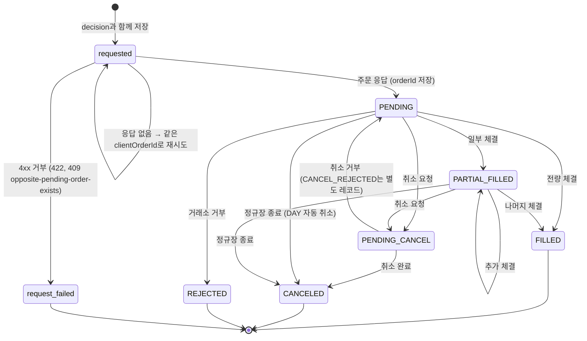
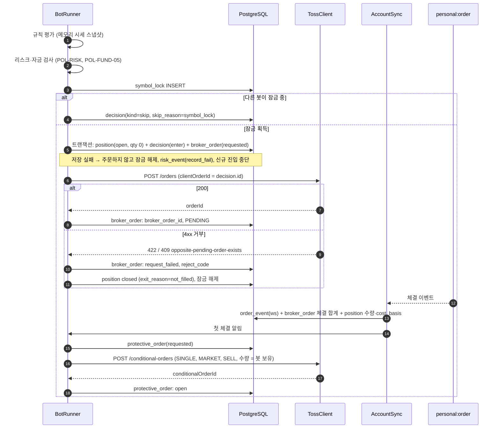
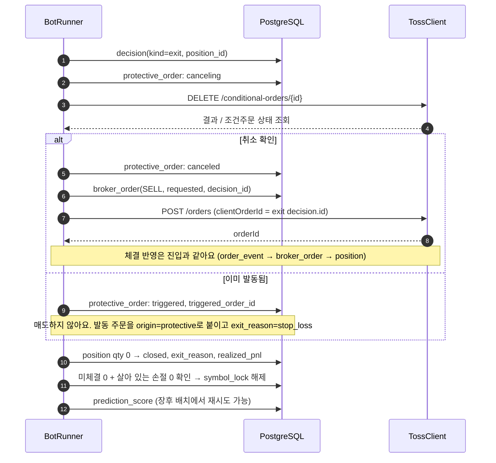

# 주문 흐름

> 상태: 초안 · 담당: @소닉 · 최종 수정: 2026-10-28
> 관련: [데이터 모델](./data-model.md) · [시스템 개요](./overview.md) · [ADR-0003](./adr/0003-record-decision-before-order.md) · [리스크 관리](../policy/risk-management.md) · [토스 API 연동](../integrations/toss-securities-api.md#주문-규칙)

판단을 기록하고, 주문을 내고, 체결을 반영하고, 포지션을 닫기까지의 순서예요. 돈이 걸린 가장 위험한 구간이라 **이중 주문, 체결 누락, 손절 공백**이 생기지 않는 것을 기준으로 정했어요. 실전(TossBroker)과 개발 점검(PaperBroker)이 같은 흐름을 따라요.

## 원칙

1. **기록 먼저, 주문 나중**: 판단(`decision`)과 주문 행(`broker_order`, `requested`)을 한 트랜잭션으로 저장한 뒤에만 토스에 주문을 보내요. 저장이 실패하면 주문하지 않아요 ([ADR-0003](./adr/0003-record-decision-before-order.md))
2. **같은 판단은 같은 주문**: `clientOrderId = decision.id`. 재시도는 항상 같은 id로 해요 (POL-RISK-07)
3. **정답은 REST 주문 조회**: 웹소켓 이벤트는 빠른 반영용이고, 합계가 다르면 `GET /api/v1/orders` 값으로 고쳐요
4. **손절은 먼저 걸고 먼저 치운다**: 진입 체결 직후 손절 조건주문을 걸고, 봇이 팔기 전에는 먼저 취소를 확인해요 (POL-RISK-11, 14)
5. **모르면 멈춤**: 주문이 접수됐는지 알 수 없으면 그 봇의 신규 진입을 멈추고 알려요 ([NFR-01](../product/prd.md#7-비기능-요구사항))
6. **정정은 쓰지 않음**: 가격·수량을 바꾸려면 취소를 확인한 뒤 새 판단으로 새 주문을 내요 ([Q-019](../project/open-questions.md#q-019))

## 주문 상태 전이

`broker_order.status`예요. `requested`와 `request_failed`는 우리 쪽 상태, 나머지는 토스 `OrderStatus` 값 그대로예요.

| 상태 | 미체결로 보나 | 다음 행동 |
| --- | --- | --- |
| `requested` | 예 | 응답을 기다리거나 [접수 확인](#응답을-못-받았을-때)을 해요 |
| `PENDING`, `PARTIAL_FILLED` | 예 | 체결을 기다려요. 청산 시각·킬 스위치면 취소해요 |
| `PENDING_CANCEL` | 예 | 취소 결과를 기다려요. 그 사이 체결이 들어올 수 있어요 |
| `FILLED` | 아니오 | 끝 |
| `CANCELED`, `REJECTED` | 아니오 | 끝. `filled_quantity`가 0보다 크면 부분 체결분은 포지션에 반영돼 있어요 |
| `request_failed` | 아니오 | 끝. 토스에 주문이 생기지 않았어요. `reject_code`에 토스 에러 코드 |

- "미체결"은 자금 한도 검사(POL-FUND-05)와 종목 잠금 해제 조건(POL-RISK-16)에 들어가요. 위 표에서 "예"인 상태를 모두 미체결로 계산해요
- `CANCEL_REJECTED`는 토스가 별도 주문 레코드로 만들어요. 원주문은 이전 상태로 돌아가므로 AccountSync는 원주문 상태만 따라가고, 이 레코드는 `order_event.raw`에만 남겨요
- 직접 거래 주문(`origin = manual`)은 우리가 상태를 바꾸지 않고 조회 결과만 따라가요. `REPLACED`·`REPLACE_REJECTED`도 직접 거래에서만 나와요

## 진입: 판단 → 주문 → 체결

- **포지션은 주문 전에 만들어요.** 판단이 `position_id`를 가져야 해서 같은 트랜잭션에서 포지션을 먼저 넣어요. 주문이 하나도 체결되지 않고 끝나면 포지션을 `not_filled`로 닫아요. F2 내역에는 "취소"로 보여요
- **손절은 첫 체결 직후 걸어요.** 체결이 이어져 보유 수량이 늘면, 기존 손절을 취소 확인한 뒤 새 수량으로 다시 걸어요(수정은 취소 후 재생성이라 새 id, [데이터 모델](./data-model.md#protective_order))
- **분할 매수**는 두 번째 주문부터 같은 포지션에 새 판단(`enter`) + 새 주문을 붙여요. 이미 잠금을 가지고 있으므로 잠금은 다시 잡지 않아요
- 체결 이벤트를 놓쳐도 아래 [재동기화](#재동기화-accountsync)가 REST 값으로 채워요

## 청산: 손절 취소 → 매도 → 포지션 종료

봇 매도(익절·청산·시간 청산·장 마감 청산·재평가 청산·수동 청산)는 모두 이 순서예요 (POL-RISK-14).

- **일부만 팔면** 남은 수량으로 손절을 다시 걸어요
- **매도가 409로 막히면**(직접 거래 반대 방향 미체결) 재시도하지 않고 `risk_event(order_rejected)`로 즉시 알려요. 사람이 그 주문을 정리해야 해요 (POL-RISK-16). 그동안 손절이 비지 않도록 남은 수량으로 손절을 먼저 다시 걸어요
- **손절이 장중에 발동**하면 AccountSync가 모르는 주문을 발견하고 `triggered_order_id`로 짝을 찾아 `origin = protective`로 넣어요. 그 체결로 포지션이 0이 되면 위와 같이 닫아요
- 실현 손익은 토스 `execution`의 `commission`·`tax`를 뺀 값이에요 (NFR-05)

## 응답을 못 받았을 때

주문을 보냈는데 응답 전에 타임아웃·네트워크 오류·engine 재시작이 나면 `broker_order`가 `requested`이고 `broker_order_id`가 비어 있어요. 이때 **같은 판단으로 새 주문을 만들지 않아요.**

| 보낸 뒤 경과 | 처리 |
| --- | --- |
| 10분 안 | 같은 `clientOrderId`로 다시 보내요. 토스가 첫 결과(`orderId`)를 돌려줘요. `409 request-in-progress`면 잠시 뒤 다시 |
| 10분 넘음 | 다시 보내지 않아요(멱등 만료라 이중 주문 위험). 주문 조회에는 `clientOrderId`가 없어서, 같은 종목·방향·수량·가격이고 `broker_order.created_at` 이후 접수됐으며 아직 어떤 `broker_order`에도 연결되지 않은 주문을 찾아요 |

| 10분 넘은 경우 찾은 결과 | 처리 |
| --- | --- |
| 1건 | 그 주문을 연결하고 상태를 따라가요 |
| 0건 | 접수되지 않은 것으로 보고 `request_failed`(`reject_code = not_found`) |
| 2건 이상 | 고르지 않아요. 그 봇 신규 진입을 멈추고 알려요. 사람이 확인해요 |

engine은 시작할 때마다 `requested` 상태 주문을 먼저 이 표대로 정리한 뒤에 BotRunner를 시작해요.

## 재동기화 (AccountSync)

웹소켓 주문 이벤트는 연결 세션 안에서만 보장되고, 끊긴 동안의 이벤트는 다시 오지 않아요 ([연동 문서 웹소켓](../integrations/toss-securities-api.md#웹소켓)). 그래서 REST로 주기적으로 맞춰요.

| 언제 | 무엇을 |
| --- | --- |
| engine 시작, 웹소켓 재연결 직후 | `GET /orders` OPEN 전량 + 오늘 CLOSED |
| 장중 주기 (예: 30초) | OPEN 전량 |
| 15:40 장후 | 오늘 CLOSED 전량으로 체결 최종 확정 (`synced_at` 갱신) |

조회한 주문마다 이렇게 맞춰요.

1. `broker_order_id`로 찾으면: 상태·체결 합계가 다르면 REST 값으로 갱신하고 `order_event(source=rest)`를 남겨요. 체결 수량이 늘었으면 포지션에도 반영해요
2. 못 찾으면 `protective_order.triggered_order_id`로 찾아요: 있으면 `origin = protective`로 넣어요
3. 그래도 없으면 [응답을 못 받은 주문](#응답을-못-받았을-때)의 후보인지 봐요. 아니면 직접 거래예요: `origin = manual`로 넣고, 같은 종목의 직접 거래 포지션(`bot_id` null)에 붙여요 (FR-MAN-01)

`ORDER_HISTORY` 한도(초당 5)는 TossClient의 rate limiter가 지켜요.

## 장 마감과 킬 스위치

| 상황 | 주문 | 손절 조건주문 |
| --- | --- | --- |
| 정규장 종료 | `DAY` 미체결은 토스가 자동 취소해요. 재동기화로 `CANCELED` 반영 | 당일 청산 봇은 만료일이 당일이라 만료. 이월 봇은 유지 |
| 당일 청산 봇의 청산 시각 | 미체결 매수 취소 → 위 청산 순서로 전량 매도 | 청산 순서 안에서 먼저 취소 |
| 봇 일시정지 | 미체결 진입 주문 취소, 보유분 유지 | 유지 |
| 봇 즉시 전량 청산 | 미체결 취소 → 청산 순서로 시장가 매도 | 청산 순서 안에서 먼저 취소 |
| 킬 스위치 | 모든 봇의 미체결 주문 취소, 신규 주문 0건 (NFR-02) | **유지**. "전량 청산"을 함께 고르면 봇별 청산 순서로 취소 후 매도 |
| engine 장애 | 주문 없음 | 유지. 서버가 없어도 손절은 증권사에서 작동해요 (POL-RISK-11) |

## 에러별 처리

| 토스 응답 | 처리 | 기록 |
| --- | --- | --- |
| `422` (`stock-restricted`, `price-out-of-range`, `insufficient-buying-power`, `order-hours-closed` 등) | 재시도 없음 | `request_failed` + `reject_code`. 진입이면 포지션 `not_filled`로 닫고 잠금 해제 |
| `422 idempotency-key-conflict` | 재시도 없음. 같은 id로 다른 내용을 보낸 코드 버그예요 | `request_failed` + `risk_event(order_rejected)`, 그 봇 정지 |
| `409 opposite-pending-order-exists` | 재시도 없음 | `request_failed`. 청산이면 즉시 알림 (위 청산 절) |
| `409 request-in-progress` | 잠시 뒤 같은 id로 재시도 | 상태 유지 (`requested`) |
| `429` | `Retry-After`만큼 기다렸다가 같은 id로 재시도 | 상태 유지 |
| `401 token-revoked` | 토큰 재발급 후 같은 id로 재시도. 반복되면 다른 곳이 같은 키로 발급 중이에요 (R-014) | 반복 시 `risk_event` + 전체 신규 진입 중단 |
| `5xx`, 타임아웃 | [응답을 못 받았을 때](#응답을-못-받았을-때) | 상태 유지 |

봇별 분당 주문 수, 계좌 일일 주문 수 상한(POL-RISK-08)은 `broker_order` INSERT 전에 검사해요. 넘으면 주문하지 않고 `risk_event(rate_cap)`로 봇을 일시 정지해요.

## 테스트로 고정할 시나리오

PaperBroker와 TossClient 모의 응답으로 아래를 테스트해요.

1. 판단 저장이 실패하면 토스 주문 호출이 0번이다
2. 주문 응답이 타임아웃 나고 5분 뒤 재시도하면 같은 `clientOrderId`로 보내고, 주문은 1건만 생긴다
3. 10분이 지난 `requested` 주문은 다시 보내지 않고, 조회 후보가 2건이면 봇이 멈춘다
4. 첫 체결 직후 손절 조건주문이 봇 보유 수량으로 걸린다. 체결이 늘면 새 수량으로 다시 걸린다
5. 청산 시 손절 취소가 확인되기 전에는 매도 주문이 나가지 않는다
6. 손절이 이미 발동됐으면 매도하지 않고 `exit_reason = stop_loss`로 닫힌다
7. 웹소켓 체결 이벤트를 하나 놓쳐도 재동기화 후 포지션 수량이 REST 체결 합계와 같다
8. 모르는 주문이 손절 발동 주문이면 `protective`, 아니면 `manual`로 분류된다
9. 청산 매도가 409로 막히면 재시도하지 않고, 남은 수량으로 손절이 다시 걸리고 알림이 간다
10. 킬 스위치 후 1초 안에 신규 주문 호출이 0건이고, 손절 조건주문은 그대로 남는다
